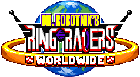

# Ring Racers Worldwide

**Client-side prediction netcode for [Dr. Robotnik's Ring Racers](https://www.kartkrew.org).**
An unofficial fork by Gibax.

  

> **Alpha.** [v0.1.2-alpha](https://github.com/GibaxLeGrand/RingRacers_Worldwide/releases)
> is the latest public test build: expect bugs, and please
> [report them](#reporting-a-problem).
>
> **This project is AI-assisted.** How, and why: [ABOUT-AI.md](ABOUT-AI.md).
>
> Not affiliated with or endorsed by Kart Krew Dev: never report this fork's
> bugs to them.

## What it does

In stock Ring Racers, nobody's input counts until the server has it, so you
feel your own ping as input delay. On a server in **WORLDWIDE mode**, your
kart answers your input at once: you see a prediction a few tics ahead, and
the server, still in charge of the race, corrects it.

On a stock 2.4 server, this build plays exactly like stock 2.4.

## Features

- **Client-side prediction** on WORLDWIDE servers: no input delay felt, from
  0 to 428 ms of ping.
- **Compatible** with stock 2.4: joins and hosts stock games with the stock
  netcode.
- **Character dubs**: a voice for every character, chosen by each player --
  Sonic in Japanese, say. See [DUBS.md](DUBS.md).
- **Two players side by side**: *Options > HUD > 2P Splitscreen > Vertical*.
- **Photo mode**: in the pause menu, offline and in replays.
- **Gyro steering**: *Profile Setup > (profile) > Accessibility*.
- **Your keyboard layout** (AZERTY and the others) in the console, the chat
  and the menus.
- **Up to 4K**, and your desktop's own resolution.
- **Windows, Linux and the Steam Deck.**

## Download

You need **Ring Racers 2.4** first, from [kartkrew.org](https://www.kartkrew.org)
(or Flathub, `org.kartkrew.RingRacers`, for the Flatpak): this fork brings
its own executable, none of the game's data.

Then, on the [Releases page](https://github.com/GibaxLeGrand/RingRacers_Worldwide/releases),
take your system's download and the **assets zip** (WORLDWIDE's title screen
and the dub packs):

| System | Download |
|---|---|
| Windows, 64-bit | `RingRacersWorldwide-<version>-windows-x64.zip` |
| Linux x86_64 (glibc 2.35+, the system's SDL2) | `RingRacersWorldwide-<version>-linux-x64.tar.gz` |
| Linux and Steam Deck, beside the official Flatpak | `RingRacersWorldwide-<version>.flatpak` |

On Windows: copy the game's zip, then the assets zip, into your Ring Racers
2.4 folder (nothing of the game's is replaced) and start
`ringracers_worldwide.exe`. Every download holds a `README-Worldwide.txt`
with the steps for each system -- also [here](release/README.txt).

## Playing online

- **Join**: *Play > Online > Browse*, or *Direct Join*. On a WORLDWIDE
  server the prediction turns itself on.
- **Host**: *Play > Online > Host Game*. WORLDWIDE mode is on by default:
  Ring Racers Worldwide players of the same version can join, stock players
  are refused with a message saying why. Forward UDP port 5029 for players
  outside your network.
- **Host for stock players**: turn off *Options > Server Options >
  Advanced... > Network Connection > WORLDWIDE Mode* before anybody joins.
- **Dedicated server**: `ringracers_worldwide -dedicated +worldwide On`.
- **The public server list** is Kart Krew's, with
  [their rules](https://ms.kartkrew.org/): set `server_contact` before going
  public.

## Known issues

- **Never raced yet by two people over the Internet**: that is what this
  alpha is for.
- Other players' karts can **jump a little** when their real input arrives.
- Above about **340 ms of ping**, what you see trails your newest input by a
  few tics.
- On **slower machines**, a wrong guess can show as a short hitch.
- **Only Race** has been played in WORLDWIDE mode; no replay is recorded
  while predicting; no `.rpt` crash report on Windows.

The full list: [release/README.txt](release/README.txt).

## Reporting a problem

On the [Ring Racers Worldwide Discord](https://discord.gg/SvWgptrUxm), or as an
[issue](https://github.com/GibaxLeGrand/RingRacers_Worldwide/issues): what
happened, the map, how many players, a WORLDWIDE or a stock server, your
system -- and the `latest-log.txt` of that session, before you start the
game again (where it is: [release/README.txt](release/README.txt)).

## How it works

Client-side prediction with server reconciliation -- not peer-to-peer
rollback: the server stays authoritative, and the game deterministic.

- The **confirmed world** runs only the tics the server has confirmed, in
  the stock lockstep. A **speculation** runs ahead of it from a snapshot,
  with your own inputs applied at once: that is what you see.
- When the server confirms what the speculation guessed, it is **kept**;
  when a guess was wrong, it is **rebuilt** from the confirmed world. A light
  correction channel replaces the stock full-state resend.
- **The server decides**: a server in WORLDWIDE mode turns it all on for the
  clients that join it.

Every measurement, with its prediction written before the run:
[docs/WORLDWIDE.md](docs/WORLDWIDE.md). The console commands:
[docs/COMMANDS.md](docs/COMMANDS.md). What comes next:
[docs/ROADMAP.md](docs/ROADMAP.md).

## Building from source

Like Ring Racers 2.4: CMake, a C17/C++20 toolchain, SDL2. On Ubuntu 22.04:

    apt-get install build-essential cmake ninja-build git pkg-config \
        libsdl2-dev libpng-dev zlib1g-dev libcurl4-openssl-dev libopus-dev
    cmake -B build -S . -G Ninja -DCMAKE_BUILD_TYPE=RelWithDebInfo \
        -DSRB2_CONFIG_ENABLE_WEBM_MOVIES=OFF -DSRB2_CONFIG_DEV_BUILD=OFF
    cmake --build build

Windows builds are cross-compiled with llvm-mingw, and the Flatpak built from
Kart Krew's Flathub manifest: the exact recipes are in
[.github/workflows/build.yml](.github/workflows/build.yml). Between releases,
every push to `alpha-2.4` is built there; the builds are the runs'
artifacts (a GitHub account needed, kept 90 days).

## Upstream, disclaimer, license

Dr. Robotnik's Ring Racers is by [Kart Krew Dev](https://www.kartkrew.org/),
based on [Sonic Robo Blast 2](https://srb2.org/), itself based on
[Doom Legacy](http://doomlegacy.sourceforge.net/); its source is
[on gitlab.com](https://gitlab.com/kart-krew-dev/ring-racers).

Dr. Robotnik's Ring Racers is a work of fan art made available for free
without intent to profit or harm the intellectual property rights of the
original works it is based on. Kart Krew Dev is in no way affiliated with
SEGA Corporation. Ring Racers Worldwide is an unofficial modification of it,
made under the same terms, not affiliated with or endorsed by Kart Krew Dev
or SEGA.

Ring Racers' source code, and this fork's, is available under the GNU General
Public License version 2.0 or higher.
